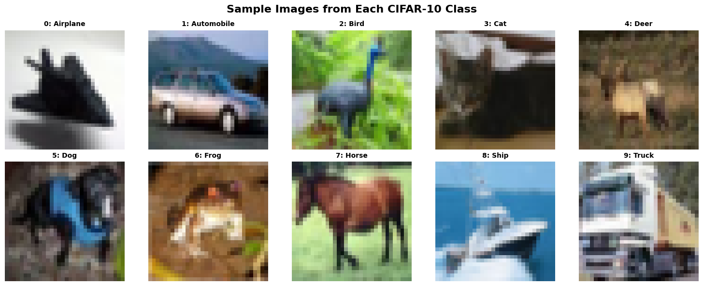
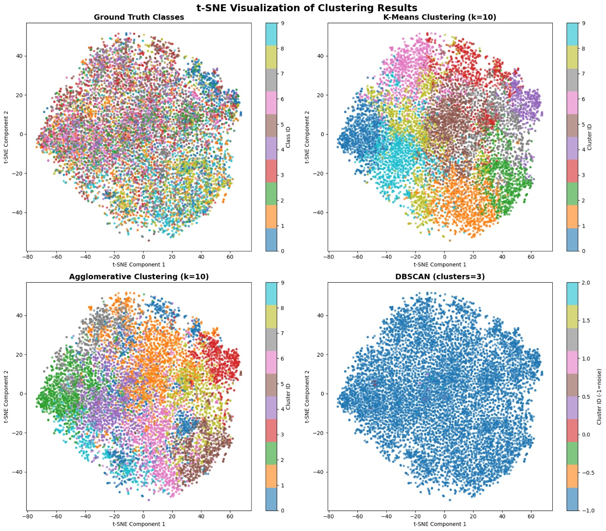

# CIFAR-10 Image Clustering with Unsupervised Learning

An **unsupervised learning** study on the CIFAR-10 image dataset. Raw pixels are standardized and compressed with **PCA**, grouped with **K-Means**, **Agglomerative Clustering** and **DBSCAN**, and the results are visualized in 2D with **t-SNE**.

Built as **HW3** for the **CENG 463 – Introduction to Machine Learning** course. The full assignment description is in [`documentation/CENG463_HW3.pdf`](documentation/CENG463_HW3.pdf).

## Pipeline

```
CIFAR-10 (50,000 × 32×32×3)
   │  flatten
   ▼
3072-dim pixel vectors ──► StandardScaler ──► PCA (50 components)
                                                   │  random sample of 10,000 images (seed 42)
                                                   ▼
                         K-Means (k=10) · Agglomerative (k=10) · DBSCAN (eps=15, min_samples=5)
                                                   │
                                                   ▼
                                     t-SNE (50D → 2D) scatter plots
```

## 1. Dataset Overview

- Loaded with `keras.datasets.cifar10`: 50,000 training and 10,000 test images, 32×32 RGB, 10 classes.
- Classes: Airplane, Automobile, Bird, Cat, Deer, Dog, Frog, Horse, Ship, Truck.



## 2. Feature Extraction & PCA

- Each image is flattened into a **3072-dimensional** vector.
- Features are standardized with `StandardScaler`.
- **PCA** reduces the dimensionality from 3072 to **50**.

## 3. Clustering

The three algorithms run on a random sample of 10,000 PCA-reduced images:

| Algorithm | Configuration | Clusters found |
| --- | --- | --- |
| K-Means | `n_clusters=10`, `random_state=42` | 10 |
| Agglomerative Clustering | `n_clusters=10` (Ward linkage) | 10 |
| DBSCAN | `eps=15`, `min_samples=5` | 3 + noise |

The notebook shows example images from each cluster for every algorithm.

## 4. Visualization & Analysis

t-SNE projects the 50-D PCA features to 2D. Each point is colored by its ground-truth class and by the label from each algorithm:



**Observations**

- The ground-truth classes are **heavily mixed** in raw-pixel PCA space. Standardized pixels mostly encode color, brightness and background rather than object identity, so no class forms a clean island.
- **K-Means** and **Agglomerative Clustering** split the space into contiguous regions, but those regions do not line up with the true classes.
- **DBSCAN** labels almost every point as noise (`-1`) at `eps=15`. In this high-dimensional space with no clear density structure, a single global density threshold does not work well.
- Clusters that match the semantic classes would need learned features, such as embeddings from a pretrained CNN, instead of raw pixels.

## Getting Started

The notebook was developed with Python 3.13.

```bash
python -m venv .venv
source .venv/bin/activate        # Windows: .venv\Scripts\activate
pip install -r requirements.txt
jupyter notebook CENG463_HW3_GROUPID.ipynb
```

> `requirements.txt` installs `tensorflow[and-cuda]`. On a machine without an NVIDIA GPU, install plain `tensorflow` instead. Keras only uses it to download and load CIFAR-10.

CIFAR-10 (~170 MB) downloads automatically on first run.

## Project Structure

```
.
├── CENG463_HW3_GROUPID.ipynb   # Full notebook with outputs
├── requirements.txt
└── documentation/
    ├── CENG463_HW3.pdf         # Assignment specification
    ├── sample_images.png       # Figures used in this README
    └── tsne_clusters.jpg
```

## Tech Stack

Python · Keras/TensorFlow (data loading) · scikit-learn · NumPy · pandas · Matplotlib · Jupyter
